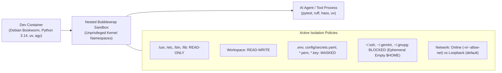

# Fortum Home Assistant Dev Container

Reproducible, hardened development container for the Fortum Home Assistant custom integration, aligned with the canonical `ha-custom-component` and `sandbox-bwrap` templates. Features nested Linux kernel Bubblewrap (`bwrap`) sandboxing for autonomous AI agent containment.

---

## 1. Features & Environment

- **Base Environment**: Debian Bookworm with Python 3.14 (`mcr.microsoft.com/devcontainers/python:3.14-bookworm`).
- **Modern Python Toolchain**: [Astral `uv`](https://github.com/astral-sh/uv) pre-installed for ultra-fast dependency management, virtualenv isolation, and testing.
- **Node.js LTS**: Installed via official Dev Container Feature (`ghcr.io/devcontainers/features/node:1`) for frontend canary testing (`scripts/test-ha-frontend-compat.sh`).
- **AI Agent Tooling**: Pre-installed [Google Antigravity CLI](https://antigravity.google) (`agy`) with host configuration mount (`~/.gemini` -> `/home/vscode/.gemini`).
- **Persistent Cache**: Docker named volume (`ha-fortum-cache`) mounted to `/home/vscode/.cache` to preserve package downloads and build artifacts across restarts.
- **Hardened Security**: Runs as non-root user `vscode` (UID 1000) with `seccomp=unconfined` and `label=disable` to allow unprivileged user namespaces (`CLONE_NEWUSER`) for nested Bubblewrap.

---

## 2. Nested Bubblewrap Sandbox (`sandbox-bwrap.sh`)

To allow autonomous AI agents (Claude Code, Antigravity, etc.) to execute safely without risk of credential exfiltration or accidental host modification, a nested Bubblewrap wrapper is provided at `.devcontainer/sandbox-bwrap.sh`.



### Execution Profiles

1. **Hydration & Build Profile (`-n` / `--allow-net`)**:
   Enables outbound network connectivity for installing packages or downloading assets:
   ```bash
   .devcontainer/sandbox-bwrap.sh --allow-net uv sync --all-extras
   ```

2. **Test & Verification Profile (Default, Network-Isolated)**:
   Passes `--unshare-net --loopback` to physically block outbound internet traffic while allowing local loopback (`127.0.0.1`) tests:
   ```bash
   .devcontainer/sandbox-bwrap.sh uv run pytest tests/
   .devcontainer/sandbox-bwrap.sh uv run ruff check .
   .devcontainer/sandbox-bwrap.sh uv run mypy custom_components tests
   ```

### Harness Integration

Templates under `.devcontainer/templates/` configure AI agent safety policies:
- **Antigravity Hooks**: `.devcontainer/templates/antigravity-hooks.json` deployed to `.agents/hooks.json`.
- **Antigravity Safety Gate**: `.devcontainer/templates/antigravity-safety-gate.sh` deployed to `.agents/safety-gate.sh`.
- **Antigravity Settings**: `.devcontainer/templates/antigravity-settings.json` deployed to `.agents/settings.json`.
- **Claude Code**: `.devcontainer/templates/claude-code-settings.json` deployed to `.claude/settings.json`.

---

## 3. Home Assistant Local Development

Home Assistant Core runs directly inside the container using the workspace `config/` directory bootstrapped by `.devcontainer/bootstrap.sh`.

1. **Bootstrap Workspace**:
   Automatically runs on container creation via `postCreateCommand`:
   ```bash
   .devcontainer/bootstrap.sh
   ```
   Symlinks `custom_components/fortum` into `config/custom_components/fortum` and initializes minimal `config/configuration.yaml`.

2. **Start Home Assistant**:
   - Run task via VS Code: `Ctrl+Shift+P` (or `Cmd+Shift+P`) -> `Tasks: Run Task` -> `Start Home Assistant`.
   - Or run from terminal:
     ```bash
     .devcontainer/start-hass.sh
     # Or directly:
     uv run hass -c config --debug
     ```

3. **Access Web UI**:
   - Open [http://localhost:8123](http://localhost:8123) in your browser (port 8123 is forwarded automatically).

---

## 4. Common Developer Workflows

```bash
# Sync all dependencies
uv sync --all-extras

# Run test suite
uv run pytest tests/

# Run targeted unit tests
uv run pytest tests/unit/

# Run linter & formatter checks
uv run ruff check .
uv run ruff format --check .

# Run static type checking
uv run mypy custom_components tests

# Run all pre-commit checks
uv run pre-commit run --all-files

# Run frontend compatibility test (Node.js)
./scripts/test-ha-frontend-compat.sh
```
