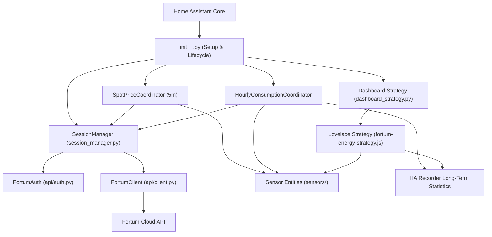

# System Architecture Overview

This document describes the architecture, subsystem boundaries, data flows, and invariants of the Fortum Home Assistant custom integration (`custom_components/fortum`).

## 1. High-Level Topology

The integration is split into two primary tracks:
1. **Backend Integration (Python)**: Authenticates with Fortum's cloud API via `SessionManager`, polls spot prices and hourly consumption via `DataUpdateCoordinator` subclasses, exposes Home Assistant entities, and writes long-term Recorder statistics.
2. **Dashboard Strategy Frontend (JavaScript / Lit)**: Serves a bundled Lovelace strategy (`custom:fortum-energy`) that queries Home Assistant Recorder statistics and entities to render energy consumption, spot price, and temperature visualizations.

## 2. Core Subsystems

### 2.1 Authentication & Session Management
* **`SessionManager` (`custom_components/fortum/session_manager.py`)**: The sole owner of authentication state, token refresh, and shared `httpx` client lifecycle. Tracks whole-integration availability transitions (`warning` on unavailable/recovered).
* **`FortumAuth` (`custom_components/fortum/api/auth.py`)**: Implements Fortum's SSO / GlobalLogin transaction-based `composite_advice` authentication flow.
* **`FortumClient` (`custom_components/fortum/api/client.py`)**: Executes authenticated API requests against endpoints defined in `api/endpoints.py`.

### 2.2 Coordinators & Data Ingestion
* **`SpotPriceCoordinator` (`coordinators/spot_price.py`)**: Polls 15-minute spot price data every 5 minutes, updates area-scoped price sensors (`[AREA]`), and writes hourly aggregated price forecast statistics (`fortum:price_forecast_<area>`).
* **`HourlyConsumptionCoordinator` (`coordinators/hourly_consumption.py`)**: Performs initial full-history sync on startup, incremental hourly updates, and post-startup background gap backfill to repair Recorder holes without blocking setup.

### 2.3 Entities & Recorder Statistics
* **Sensors (`sensors/`)**: `metering_point.py`, `price.py`, `tomorrow_price.py`, `stats_last_sync.py`, plus optional current-month consumption/cost sensors.
* **Buttons (`button.py`)**: Manual diagnostic/debug actions (e.g., `Backfill Historical Gaps`), hidden by default.
* **Recorder Statistics**: Writes hourly `energy`, `cost`, `price`, and `temperature` statistics per metering point.

### 2.4 Dashboard Strategy Frontend
* **Source**: `custom_components/fortum/frontend/src/fortum-energy-strategy.js` (built with `esbuild` via `build.js` into `dist/fortum-energy-strategy.js`).
* **Registration**: `dashboard_strategy.py` registers `/fortum-energy/fortum-energy-strategy.js` as a Lovelace module resource with cache headers and optionally auto-creates the Fortum dashboard.

## 3. Architectural Invariants

| Invariant | Scope | Enforcement Mechanism |
| :--- | :--- | :--- |
| **Single Config Entry** | `manifest.json` (`"single_config_entry": true`) | Prevents cookie collision on the shared HTTP client; enforced by HA config flow. |
| **SessionManager Ownership** | `session_manager.py` | All API reads/writes and cookie clearing must go through `SessionManager`; no direct side-channel `FortumClient` / `FortumAuth` access from coordinators. |
| **Price-Presence Marker** | `HourlyConsumptionCoordinator` | `price` presence (`price is not None`) marks valid hourly core metrics (`energy`, `cost`, `price`); temperature-only hours are excluded from core metric imports. |
| **Non-Blocking Gap Backfill** | `HourlyConsumptionCoordinator` | Post-startup historical gap backfill runs in the background after setup completes. |
| **No Backward-Compat Aliases** | Repository-wide | Canonical names/paths only; references are updated directly without legacy aliases. |
| **No Secret Logging** | Repository-wide | Tokens, cookies, passwords, and raw session payloads must never be logged. |
